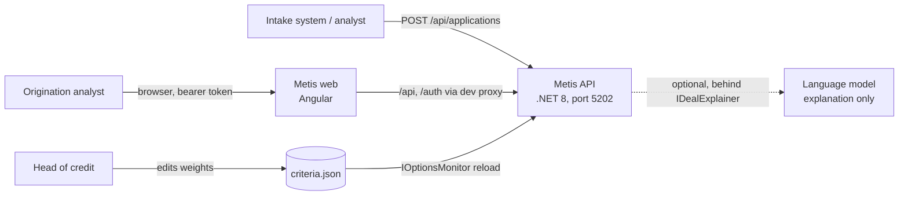

# Architecture

## Style and why
Advisor output (traits: ComplexBusinessRules, DocumentIngestion, SmallTeam):

### Recommendation: CleanArchitecture

One business area with rules that must be tested without the database or UI. Keep the domain at the centre.

#### Patterns
- **SeparateIngestionPipeline**: Documents arrive in bursts; queue them and process in a worker so the API stays responsive.
- **HumanInTheLoop**: AI extraction is never 100%: route low-confidence fields to a person and learn from their corrections.
- **AuditTrail**: Keep the source document, the extracted value and who approved it, so every number can be traced.

#### Closest reference systems
- Document extraction with human review (similarity 0.75): Clean Architecture API plus a worker fed by a queue; fields the model is unsure about wait for a person.
- Employee tool (leave, timesheets) (similarity 0.50): Monolith: layered, or Clean Architecture if the approval rules are complex.
- Simple static site (similarity 0.25): No backend at all: static hosting plus one small serverless function for a contact form.

#### Risks to watch
- Trusting AI output blindly. Validate against a schema and keep a person in the loop.

#### Evolve when
- A second business area appears with its own language: make it a module of a modular monolith.

Record the final choice with write_adr, including what you rejected.

Judgement: Build a Clean Architecture rules engine for the score, with the model limited to writing the explanation. See `decisions/0001-architecture-style.md`.

Refinement: vertical slices around a pure, config-weighted rules engine (`decisions/0002-vertical-slices-with-explainable-rules-engine.md`). Building blocks vendored (`decisions/0003-vendored-building-blocks.md`).

## Context

## Modules and boundaries
| Module | Owns | Features (one folder each: Request, Validator, Handler, Endpoint) | May call |
|---|---|---|---|
| `Metis.Intake` | Applications (in-memory store; database in slice 2), demo seed | `SubmitApplication` (POST /api/applications, client id = idempotency), `GetApplication` (GET /api/applications/{id}) | Blocks Core/Web only |
| `Metis.Triage` | Scoring criteria, rules engine, ranking, explanation port | `GetQueue` (GET /api/queue), `GetCriteria` (GET /api/criteria) | `Metis.Intake.Contracts` only |
| `Metis.Api` | Composition root: Blocks Web + Auth, `/api` group with auth, criteria file | none | both modules' public `Add*/Map*` |

Shared (non-slice) code: `Triage/Scoring` (criteria, engine, ranker, policy + version, provider with last-good fallback), `Triage/Explanation` (port, template adapter, guard), `Intake/Data`, `Intake/Shared`.
Rules enforced by `tests/Metis.Tests/ArchitectureTests.cs`.

## Cross-cutting
- Auth: Agentic.Blocks.Auth bearer tokens; `/api/*` requires a signed-in user; submit requires role `origination`. Demo users in Development only.
- Errors: ProblemDetails via Agentic.Blocks.Web (`Result`/`Error` mapped to 400/404/409); correlation id on every response.
- Health: `/health/live`, `/health/ready`.
- Configuration: `criteria.json` (reload on change, validated by `ScoringOptionsValidator`, last good kept); `DemoUsers__Password`, `CriteriaFile` (see `.env.example`).
- Time: `TimeProvider` everywhere (tests use `ManualTimeProvider`). Money: `decimal` via Blocks `Money`.
- Logging: source-generated `LoggerMessage`; logs carry criteria versions and adapter names, never application data.
