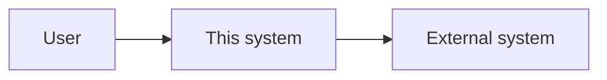

# Architecture

## Style and why
Advisor output (traits: ComplexBusinessRules, DocumentIngestion, SmallTeam):

### Recommendation: CleanArchitecture

One business area with rules that must be tested without the database or UI. Keep the domain at the centre.

#### Patterns
- **SeparateIngestionPipeline**: Documents arrive in bursts; queue them and process in a worker so the API stays responsive.
- **HumanInTheLoop**: AI extraction is never 100%: route low-confidence fields to a person and learn from their corrections.
- **AuditTrail**: Keep the source document, the extracted value and who approved it, so every number can be traced.

#### Closest reference systems
- Document extraction with human review (similarity 0.75): Clean Architecture API plus a worker fed by a queue; fields the model is unsure about wait for a person.
- Employee tool (leave, timesheets) (similarity 0.50): Monolith: layered, or Clean Architecture if the approval rules are complex.
- Simple static site (similarity 0.25): No backend at all: static hosting plus one small serverless function for a contact form.

#### Risks to watch
- Trusting AI output blindly. Validate against a schema and keep a person in the loop.

#### Evolve when
- A second business area appears with its own language: make it a module of a modular monolith.

Record the final choice with write_adr, including what you rejected.

Judgement: Build a Clean Architecture rules engine for the score, with the model limited to writing the explanation. See `decisions/0001-architecture-style.md`.

## Context

## Modules and boundaries
TODO: each module, what it owns, what it may call.

## Cross-cutting
TODO: auth, logging, tracing, configuration, error handling.