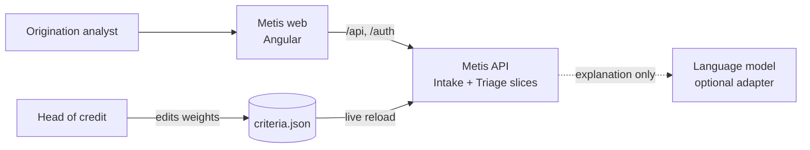

# Metis

Metis ranks Harbourline Lending's inbound loan applications by explainable lending criteria, so strong deals stop waiting behind weak ones. (Harbourline is a fictional lender; all data is invented.)

## Design at a glance
**Brief.** Applications are reviewed first-come-first-served. Metis scores every open deal on five weighted criteria (loan-to-value, debt service cover, sponsor track record, asset type, location), ranks the queue and gives each rank a one-paragraph reason naming the three criteria that moved it most. Goal: top-decile deals reviewed within 24 hours.

**Architecture.** A modular monolith with two modules (Intake, Triage), each organised as **vertical slices**: one folder per feature holding its request, validator, handler and endpoint. Scoring is a pure, deterministic rules engine whose weights live in `criteria.json` and reload through `IOptionsMonitor`, so the head of credit can re-rank without a deploy. A language model may only write the explanation, behind the `IDealExplainer` port and a guard (a template adapter ships today). We chose slices over the advisor's Clean Architecture recommendation because the rules are one scoring function, not a deep domain, and a small team ships features faster when a change touches one folder; ADR-0002 records when to switch. Full reasoning, capacity, failure modes and Q&A: [`docs/DESIGN.md`](docs/DESIGN.md).




## Run it in GitHub Codespaces

[](https://codespaces.new/Legion91919/metis?quickstart=1)

The dev container installs the SDKs, restores packages and runs every test once on first start. The same setup works locally with VS Code's Dev Containers extension.

| What | Command | Port |
|---|---|---|
| API (Metis) | `ASPNETCORE_ENVIRONMENT=Development ASPNETCORE_URLS=http://0.0.0.0:5202 dotnet run --project src/Metis.Api` | 5202 |
| Web app | `cd web && npm start -- --allowed-hosts .app.github.dev --allowed-hosts localhost` | 4202 |
| All tests (same as CI) | `scripts/test-all.sh` | - |

## What it does (slice 1)
- `GET /api/queue`: ranked open deals with score (0-100), top three signed movers, a one-paragraph reason, waiting hours and first-come-first-served position, stamped with a `criteriaVersion`.
- `GET /api/criteria`: weights in use, their shares and the last refused edit, if any.
- `POST /api/applications` (client-generated id makes retries safe; same id with a different body is 409), `GET /api/applications/{id}`.
- Sign-in via Agentic.Blocks.Auth (`/auth/login`), ProblemDetails errors, `/health/live` and `/health/ready`.
- Angular queue screen: summary strip, ranked table, expandable reasons, loading/empty/error/success states.

## Run locally
```bash
export DemoUsers__Password='pick-a-local-demo-value'
ASPNETCORE_ENVIRONMENT=Development ASPNETCORE_URLS=http://localhost:5202 dotnet run --project src/Metis.Api
cd web && npm install && npm start      # http://localhost:4202, proxies to :5202
```
Tests: `dotnet test Metis.sln`; `cd web && npm test && npm run build`. Details in `.agentic/runbook.md`.

## How this project is organised
`src/Metis.Api` (composition root), `src/Modules/Intake`, `src/Modules/Triage` (each with `Features/<Feature>/`), `tests/Metis.Tests`, `web/` (Angular), `eng/packages` (vendored building blocks), `docs/DESIGN.md`.
Project knowledge lives in the hidden `.agentic/` folder (start with `.agentic/README.md`). AI agents read `AGENTS.md` first.

Built with the Baton model from the Agentic Engineering Kit: frame → map → decide → sketch → slice loop → pass the baton.
