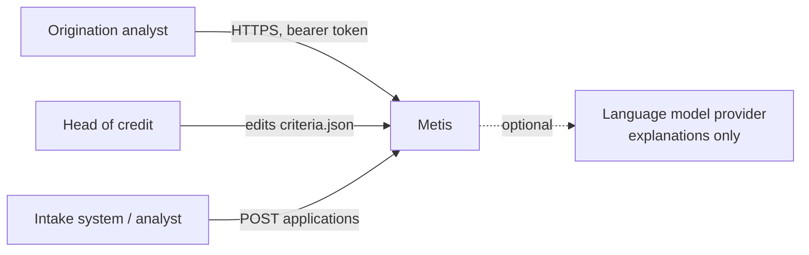
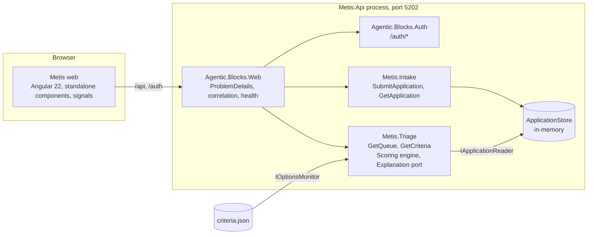
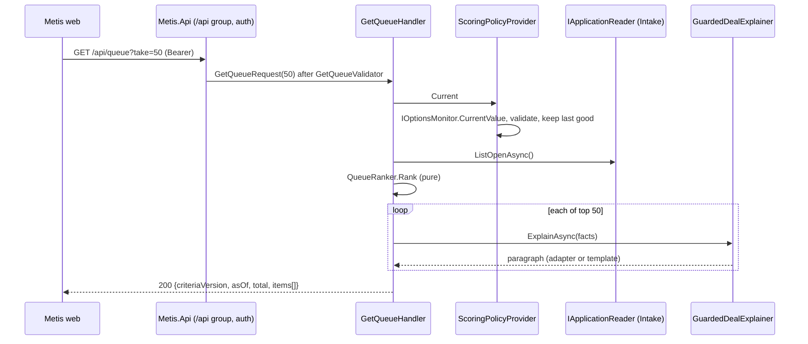
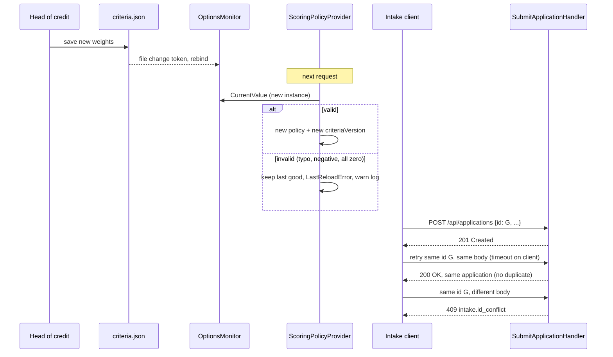
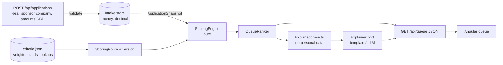
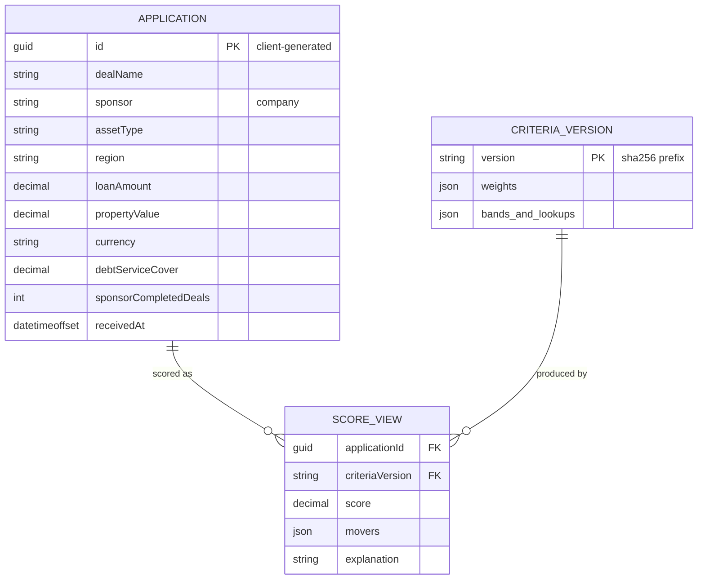

# Metis: design dossier

> Harbourline Lending is a fictional company. All names, documents and numbers are invented.

## 1. Brief
- **Client:** Harbourline Lending, a commercial real-estate lender.
- **Problem:** inbound loan applications are reviewed first-come-first-served, so strong deals wait behind weak ones.
- **Users:** origination analysts (daily, desktop, expert); the head of credit (sets criteria weights).
- **Outcomes:** top-decile deals reviewed within 24 hours; every rank explainable in one paragraph.
- **Constraint:** no unexplained model scores.

## 2. Requirements
**Functional (slice 1)**
1. Origination sees today's queue ranked by criteria score, with a one-paragraph reason per deal.
2. The same weights and deals always give the same order (ties: oldest arrival, then id).
3. Each reason names the top three criteria that moved the score, with signed points.
4. Changing a weight in configuration re-ranks on the next request, without a deploy.
5. Intake can submit applications safely with retries (client-generated id).

**Non-functional**
| Concern | Target | Source |
|---|---|---|
| Queue latency | p95 < 300 ms for <= 500 open deals | `quality.md` |
| Availability | 99.9% / 30 days for `GET /api/queue` | `quality.md` |
| Criteria freshness | new weights served < 10 s after save | AC "without a deploy" |
| Explainability | 100% of ranks carry movers + paragraph + `criteriaVersion` | `product.md` constraint |
| Privacy | no personal data in slice 1 (sponsors are companies); logs hold no application data | POPIA/GDPR minimisation |
| Retention | applications kept 7 years once persisted (lending records; assumption to confirm with client) | assumption |

## 3. Capacity estimate
Assumptions (to confirm with Harbourline): 40 applications per working day, 250 working days, 20 analysts, 30 queue reads per analyst per day.
- Writes: 40/day ≈ 0.0005 req/s. Peak (a broker batch) 50 in a minute ≈ 1 req/s.
- Reads: 20 × 30 = 600/day; peak 20 analysts at 09:00 refreshing every 10 s ≈ **2 req/s**.
- Open queue: ~10 working days of backlog × 40 = **400 deals**. Scoring = 400 × 5 criteria of decimal arithmetic ≈ well under 1 ms; sorting 400 items is negligible. Payload ≈ 400 × 1.2 KB ≈ 0.5 MB (`take` defaults to 50 ≈ 60 KB).
- Storage: application record ≈ 2 KB → 10,000/year ≈ **20 MB/year**. PDF packs (slice 3) ≈ 20 MB each → **200 GB/year**: blob storage, not the database.
- With an LLM explainer: 600 reads × 50 items would be 30,000 calls/day, so explanations are cached per (application id, criteriaVersion): ≈ 40 new + 400 per weight change.

## 4. Options considered
`arch-advisor compare ComplexBusinessRules DocumentIngestion SmallTeam`:

| Option | Fit | Complexity (1-5) | Main reason |
|---|---|---|---|
| Clean Architecture monolith | Recommended | 2 | Matches the advisor's recommended style (CleanArchitecture). |
| Layered monolith | Possible | 1 | Small team: low enough operational load to run comfortably. |
| Vertical slice monolith | Possible | 2 | Small team: low enough operational load to run comfortably. |
| Modular monolith | Possible | 3 | Small team: low enough operational load to run comfortably. |
| Modular monolith + CQRS read models | Possible | 3 | Small team: low enough operational load to run comfortably. |
| Serverless functions + queues | Possible | 3 | Small team: low enough operational load to run comfortably. |
| Static site + serverless function | Poor fit | 1 | The product has real server-side behaviour and data; a static site can't hold it. |
| Event-sourced core with CQRS | Poor fit | 4 | Event sourcing's cost isn't repaid without audit, money or replay needs. |
| Microservices (request/response) | Poor fit | 5 | A small team can't run a distributed system well (deployments, tracing, on-call). |
| Event-driven microservices | Poor fit | 5 | A small team can't run a distributed system well (deployments, tracing, on-call). |

- **Clean Architecture monolith (advisor's pick): not chosen, but close.** Its strength is keeping rules testable without the database or UI. Here the rules are one pure function (`ScoringEngine`) that is already tested without HTTP or storage, so Domain/Application/Infrastructure projects would add mapping and indirection without new protection.
- **Vertical slice monolith (chosen, inside two modules).** "A change touches one folder; easy for agents and new joiners to extend safely." Its risk, "shared rules duplicated across slices", is handled by keeping the engine in `Scoring/` outside any slice and by an architecture test that forbids slice-to-slice references.
- **Modular monolith:** we take its boundary idea (Intake vs Triage with a public contract) but not separate data stores per module yet.
- **Serverless + queues:** a good fit later for PDF pack bursts (slice 3 worker), not for the interactive queue.
- **Event sourcing, microservices:** poor fit: no replay need, one small team.

**Global scale answer:** at 100x (4,000 applications/day, several regions) the API stays a monolith with a read model for the queue (section 9); only document extraction would be extracted into its own scalable worker.
**Evolution trigger (ADR-0001):** a second business area with its own language (e.g. servicing or credit committee) becomes its own module; if its rules grow aggregates and invariants, that module uses Clean Architecture inside.

### Vertical slices vs Clean Architecture, and when to choose each
| | Vertical slices (Metis) | Clean Architecture |
|---|---|---|
| Unit of organisation | a feature: `Features/GetQueue/{Request, Validator, Handler, Endpoint}` | a layer: Domain, Application, Infrastructure, Api projects |
| Where a change lands | usually one folder | one file in each of 3-4 projects |
| Dependency rule | slices don't reference each other; shared code (engine, store) sits beside them | dependencies point inward to the domain; outer layers implement inner ports |
| Abstractions | only where they pay (`IApplicationReader`, `IDealExplainer`) | a port per outside concern, by default |
| Rules isolation | by discipline + tests (pure `Scoring/`, architecture tests) | by project references (the compiler enforces it) |
| Risk | duplication between slices, a "shared" folder that grows into a god module | ceremony, anaemic use cases that only pass data through |
| Choose when | many small features in one area, small team, rules concentrated in a few pure functions, agents adding features | rich domain (aggregates, invariants, state machines), several adapters per port, long-lived core shared by many features |

Both can coexist: a module can be slices outside and Clean inside. If credit committee approvals arrive (states, conditions, covenants), that module would start with Clean Architecture.

## 5. Architecture
**C4 context**

**C4 containers**

| Module | Owns | Public contract | Depends on |
|---|---|---|---|
| `Metis.Intake` | applications, their validation and demo seed | `Contracts.IApplicationReader`, `ApplicationSnapshot`, `AssetTypes`; `AddIntakeModule`, `MapIntakeEndpoints` | Blocks Core, Web |
| `Metis.Triage` | criteria, scoring, ranking, explanations | `IDealExplainer`, `ExplanationFacts`, `ScoreMover`; `AddTriageModule`, `MapTriageEndpoints` | Intake contracts, Blocks Core, Web |
| `Metis.Api` | composition, auth policy, criteria file | none | modules, Blocks Auth |

**The rules engine.** Every deal starts at 50. Each criterion yields a sub-score 0..1 (LTV and DSCR linear between configured best/worst, sponsor deals / deals for full marks, asset type and region from lookup tables; unknown = 0, "not in criteria"). Points = weight / total weight × (sub-score − 0.5) × 100, so the score is the weighted average on 0..100 and each criterion's points say exactly how far it moved the deal. Top three movers = largest |points| among criteria with weight > 0, ties in canonical order (LTV, DSCR, sponsor, asset type, location). All arithmetic is `decimal`; the ranking is a total order (score desc, received asc, id asc). The policy carries `criteriaVersion` = first 8 hex chars of SHA-256 over a canonical form of the options.

**The explanation port and the LLM adapter (documented, not built).** `IDealExplainer.ExplainAsync(ExplanationFacts)` gets only decided facts: deal name, rank, queue size, score, three movers (criterion, evidence, points), remaining points and version. `GuardedDealExplainer` wraps whatever adapter is registered: 2 s timeout, then `ExplanationGuard` (one paragraph, <= 800 chars, names every mover) or the template. An `LlmDealExplainer` would:
1. Be registered before `AddTriageModule` (`services.AddSingleton<IDealExplainer, LlmDealExplainer>()`); `TryAdd` keeps the template otherwise.
2. Send a fixed system prompt ("Write one paragraph for a credit analyst. Use only these facts. Do not add numbers. Do not recommend approval.") plus the facts as JSON; temperature 0.
3. Use `IHttpClientFactory` with a timeout and retry with jitter; never send sponsor or deal identifiers beyond the deal name (or replace it with a placeholder and substitute after).
4. Cache by (application id, criteriaVersion); log fallback rate (SLO in `quality.md`); keep an eval set of facts → acceptable paragraphs and run it when the prompt or model changes.
It can never change score, rank or movers: those are computed before it is called and shown separately in the UI.

## 6. Communication flows
**Slice 1: load the queue (sync)**

**Riskiest flows: a weight edit, and a retried submission**

All calls are synchronous in slice 1; the client-supplied id is the idempotency key. No outbox yet: no cross-module events (slice 3's ingestion worker will add a queue).

## 7. Data flow

Money: loan amount and property value (`Money`, decimal, ISO currency). Personal data: none in slice 1 (sponsor = company). Slice 3 PDF packs may contain names and signatures: they stay in blob storage and never reach the explainer.

## 8. Data model

| Entity | Owner | Consistency |
|---|---|---|
| Application | Intake | strong (single writer; id unique) |
| Criteria version | Triage (file today) | read-your-writes within seconds of a save |
| Score view | Triage, computed on read (not stored in slice 1) | always consistent with the live criteria; cached per version when an LLM is used |

## 9. Scaling path
1. **Explainer cost first** (if an LLM is used): cache by (id, version); pre-compute on submit and on criteria change.
2. **Persistence** (slice 2): Postgres/SQL Server behind `IApplicationReader`; index `(status, received_at)`.
3. **Queue read model**: when open deals exceed ~10k, materialise scores per criteria version on write/criteria change; serve pages with keyset pagination (Blocks Core).
4. **More instances**: stateless API behind a load balancer; persist the Data Protection key ring for tokens; criteria from a shared config store with change notification.
5. **Document extraction** (slice 3): separate worker fed by a queue; scales independently; the only part worth extracting as its own service.

## 10. Failure modes
| Failure | Effect | Mitigation |
|---|---|---|
| Invalid criteria edit | could zero or break all ranks | validator refuses; last good stays live; `lastReloadError` + warning log |
| Invalid criteria at first start | no valid policy | start-up check fails fast (`ScoringPolicyStartupCheck`) |
| LLM slow, down or off-script | queue waits or shows bad text | 2 s timeout, guard, template fallback; fallback-rate SLO |
| Duplicate submission (retry) | double-counted deal | client id; same body replays 200, different body 409 |
| API down | analysts see nothing | web shows error state with Retry, never stale ranks |
| Hot read at 09:00 | latency spike | scoring is in-process and cheap; read model if needed (section 9) |
| Region outage | no service | slice 2: second region warm standby; RPO from DB replication |
| Unknown asset type/region | silently low score | sub-score 0 with evidence "not in criteria", visible as a mover |

## 11. Security and privacy
- **AuthN:** Agentic.Blocks.Auth (PBKDF2 600k, lockout, opaque bearer tokens, rotation on logout). Swap to the client's OIDC provider without touching endpoints (see block README).
- **AuthZ:** `/api/*` requires a signed-in user; submitting requires role `origination`; criteria are read-only over HTTP (edits go through the file and its change control).
- **Data protection:** no personal data in slice 1; invented demo data only; logs contain versions and adapter names, not application content; the explainer receives facts only (data minimisation for POPIA/GDPR).
- **Secrets:** none in the repo; demo password from `DemoUsers__Password` (`.env.example`); gitleaks + privacy guard in CI.
- **Threats per flow:** queue (token theft → short-lived tokens, HTTPS); submit (mass submission → rate limits from Blocks Web, validation); criteria (unauthorised edit → file permissions/config store RBAC; every rank shows its version); explainer (prompt injection through deal names → guard + facts-only prompt, output never affects ranking).

## 12. Observability
- **SLIs/SLOs:** see `.agentic/quality.md` (queue success 99.9%, p95 < 300 ms, criteria freshness < 10 s, explainer fallback < 5%, top-decile reviewed within 24 h).
- **Logs:** "Scoring criteria {Version} are live", "Criteria edit refused, keeping {Version}", explainer fallbacks; every log line carries `CorrelationId` (Blocks Web).
- **Metrics to add with OpenTelemetry (slice 2):** queue latency histogram, open deals, top-decile deals waiting > 24 h (the product outcome), explainer fallback count.
- **The alert that wakes someone:** queue error budget burning 10x for 1 hour. "Top-decile deal waiting > 24 h" goes to the origination lead in working hours, not to on-call.

## 13. Testing strategy
| Layer | Here | Count |
|---|---|---|
| Rules | `ScoringEngineTests`: weighted score, determinism under input order, tie-breaks, top movers, zero weight, LTV bands, unknown lookups, version hash, validator | 16 |
| Explainer | `ExplainerTests`: template paragraph, guard fallbacks (multi-paragraph, missing mover, empty, adapter exception), good adapter text kept | 6 |
| Acceptance (real HTTP, Kestrel, seeded data, ManualTimeProvider) | `QueueAcceptanceTests` (AC1, AC2, AC3, invalid edit, 401, take validation, empty) and `IntakeAcceptanceTests` (idempotent submit, scoring of a new deal, validation, 404, health) | 12 |
| Boundaries | `ArchitectureTests`: no slice-to-slice references, four parts per slice, Triage uses only Intake contracts, no reverse reference, internals only to tests | 5 |
| Web | Angular unit-test builder (Vitest + jsdom): queue logic (summary, signs, states, money) and `QueuePage` with `HttpTestingController` (success, empty, error + retry) | 7 |
| Journeys | Playwright + axe for flow 1: backlog | 0 |

Acceptance criteria map: AC1 → `AC1_*` + engine determinism tests; AC2 → `AC2_*` + mover and explainer tests; AC3 → `AC3_*` + invalid-edit test + smoke test that edits the criteria file of a running API.

## 14. Interview questions
1. **Why not let the model score deals?** Nobody could explain or audit a rank, and the product constraint forbids it. The model only rephrases decided facts, behind a guard with a template fallback.
2. **How do you prove the order is deterministic?** Decimal arithmetic, fixed criterion order, and a total ordering (score, arrival, id). Tests rank the same deals in different input orders and compare full JSON responses from two calls.
3. **What does "moved the score" mean exactly?** Each criterion's signed contribution relative to a neutral 50: weight share × (sub-score − 0.5) × 100. The top three by absolute value are the movers; their points plus the rest add up to the score.
4. **How does a weight change take effect without a deploy, and what if someone makes a typo?** `criteria.json` reloads on change; the provider reads `IOptionsMonitor` per request. Validation runs in the provider: unknown keys, negative or all-zero weights are refused and the last good criteria stay live. Every response carries the `criteriaVersion`.
5. **Why vertical slices when the advisor said Clean Architecture?** One small area, rules concentrated in one pure engine, features that are mostly independent. Slices keep changes local; architecture tests stop slices coupling. We would switch a module to Clean Architecture when it grows real aggregates and invariants.
6. **What happens when the intake system retries a POST?** The client-generated id is the idempotency key: same body replays 200 with the stored application, a different body is 409.
7. **How would you scale to 100x applications?** Persist, cache explanations per version, then a materialised queue read model with keyset pagination; extract only the PDF extraction worker.
8. **How do you stop an LLM explanation from misleading an analyst?** It sees only facts, its output must name every mover in one short paragraph, it times out at 2 s, and score, movers and version are shown separately from the prose.
9. **How would you audit a past ranking?** Persist criteria versions with their content (slice 2) and log the version with each queue read; any rank can be recomputed from the application and that version.
